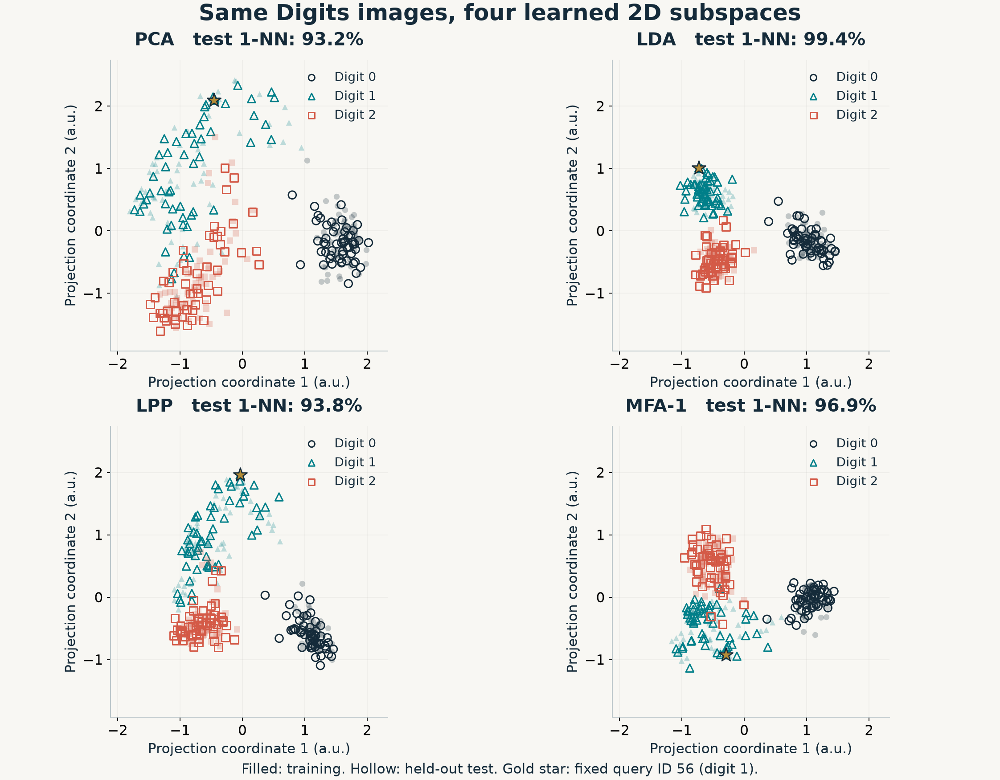

# MFA 2007: CPU reproduction

[中文说明](README.zh-CN.md)

An independent Python implementation of **Marginal Fisher Analysis and Its Variants for Human Gait Recognition and Content-Based Image Retrieval**, Xu et al., IEEE TIP 2007. [Paper DOI](https://doi.org/10.1109/TIP.2007.906769).

Implements MFA-1, MFA-2, Matrix-based MFA (MMFA), MBA/KMBA, BDA/KBDA baselines, gait-cycle averaging and sequence matching. Uses NumPy/SciPy on CPU; no GPU is required. This is an educational, AI-assisted reimplementation, rather than the authors' official code.

The checked experiments use Digits, Olivetti and a Corel1K mirror, plus synthetic gait fixtures. **The original USF and Corel22K benchmark tables have not been reproduced.**

## Install and check

Python **3.12** and Git are needed. From the repository root:

```sh
python3.12 -m venv .venv
source .venv/bin/activate
python -m pip install -r requirements.txt
python -m unittest discover -s code -p 'test_*.py' -v
python code/check_paper_contract.py
```

On Windows, create the environment with `py -3.12 -m venv .venv` and activate `.venv\Scripts\Activate.ps1`. The tests and snapshot check require no dataset downloads. The suite contains 28 mathematical, interface and feedback-isolation checks.

The final command checks the saved source/result hashes, hand-calculated graph edges, shared MFA-1/MFA-2 graphs and fixed classification settings. Rerunning experiments overwrites result files; use a separate checkout to retain the published snapshot.

## Run experiments

```sh
# Small Digits experiment; uses scikit-learn's bundled dataset.
python code/run_experiment.py

# Fetch Olivetti and the pinned Corel1K mirror, with file-hash checks.
python code/prepare_data.py

# Three classification splits, feedback retrieval and synthetic gait checks.
python code/run_all.py

# Controlled 3-class, 2D comparison, then rebuild the offline demo.
python code/visual_comparison.py
python demo/build_demo.py
```

`prepare_data.py` requires network access and Git. Original images, pretrained models, licensed paper PDFs and course materials are not bundled. Corel descriptors are generated locally before retrieval runs. Full retrieval experiments take longer than the small checks.

Open [demo/index.html](demo/index.html) in a browser to inspect the saved PCA/LDA/LPP/MFA-1 projections, digit images and nearest neighbors. It works offline with embedded data. [Demo instructions](demo/README.md).

## Definitions follow the paper

- **k1:** same-class neighbors selected for each training sample, Eq. (5).
- **k2:** nearest cross-class pairs selected for each class against all other classes together, Eq. (6). Selected edges form an undirected union.
- Classification fixes **k1=3, k2=50**, seeds **16/17/18**, and 1-NN evaluation.
- **MFA-1:** the paper's Ratio Trace/GED route, with 98% PCA preprocessing.
- **MFA-2:** the paper's direct Trace Ratio iteration, Procedure 2, on the positive support of A+B.

Both solver names appear in the paper. MMFA here means **Matrix-based** MFA. The shared-PCA MFA-2 run is a preprocessing diagnostic, not another named paper variant. [Definitions and numerical conventions](docs/PAPER_DEFINITIONS.md).

## Saved experiments

| Method | Digits accuracy (%) | Olivetti accuracy (%) |
|---|---:|---:|
| Raw pixels | 98.02 | 91.25 |
| PCA | 97.28 | 88.54 |
| LDA | 94.32 | 96.25 |
| MFA-1 | 96.91 | 94.17 |
| MFA-2 | 81.67 | 92.50 |
| MMFA | 95.43 | 90.21 |

Means across three fixed splits. Per-split values, standard deviations, predictions and indices are retained in [classification.json](results/round2/classification.json) and the neighboring NPZ files. Most reduced outputs are 16D; Digits LDA has 9D. Raw pixels retain their original dimension.

In the adapted Corel1K held-out protocol, round-5 P@20 is BDA 80.50%, KBDA 82.20%, MBA 54.60%, KMBA 64.30%. These substitute experiments do not reproduce the original paper's method ranking. KBDA is our regularized kernel BDA baseline, not the paper's KDBDA. [Protocols and results](docs/EXPERIMENTS.md).



## Repository map

- `code/`: implementation, experiment entry points and tests.
- `results/`: saved JSON, split/prediction arrays and scientific figures.
- `demo/`: standalone interactive comparison and its builder.
- `docs/`: definitions, experimental scope and upstream provenance.
- `reproduction-manifest.json`: algorithm and result SHA-256 values.
- `tools/fetch_references.py`: optional pinned upstream downloads for advanced reference checks; their source is not redistributed here.

Core numerical files are unchanged from the checked local implementation. Export changes affect file locations and the PDF-independent snapshot check. See [provenance](docs/PROVENANCE.md) and [implementation notes](code/implementation-notes.md).

## Citation and license

Please cite the original paper when discussing the algorithm; BibTeX is in [paper.bib](paper.bib). This repository's original code is released under the [MIT license](LICENSE). Dataset and upstream source licenses remain with their respective owners; upstream URLs and commits are documented in [references](docs/REFERENCES.md).
